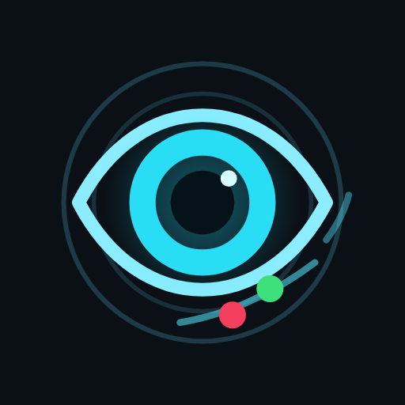

# ThirdEye · Dungeon Dev Labs

**English** · [Português](#português)

Android app to watch and record NETIP IP cameras, with scheduled routines and Drive sync. The app code is private; this repo holds its public documents.

## What's here
| File | Purpose |
| --- | --- |
| [`public/politica-de-privacidade.md`](public/politica-de-privacidade.md) | Privacy policy (Portuguese only), linked from the Play Store |
| [`public/servico-em-primeiro-plano.md`](public/servico-em-primeiro-plano.md) | Foreground service declaration text for the Play Store |
| [`public/assets/`](public/assets) | App screenshots |
| [`DUNGEON.md`](DUNGEON.md) | Card data for the Dungeon Dev Labs home page |

## Privacy
[Privacy policy](public/politica-de-privacidade.md) (Portuguese) · [Google Play](https://play.google.com/store/apps/details?id=app.dungeondevlabs.thirdeye)

## Community
Found a bug or have a suggestion? Open an [Issue](../../issues) or write to luidy.moura.dev@gmail.com.

## AI
Built with AI dev copilots. Images generated by AI.

---

## Português

App Android para ver e gravar câmeras IP NETIP, com rotinas agendadas e sincronização no Drive. O código do app é privado; este repo guarda os documentos públicos dele.

### O que tem aqui
| Arquivo | Para que serve |
| --- | --- |
| [`public/politica-de-privacidade.md`](public/politica-de-privacidade.md) | Política de privacidade, linkada na Play Store |
| [`public/servico-em-primeiro-plano.md`](public/servico-em-primeiro-plano.md) | Texto da declaração de serviço em primeiro plano da Play Store |
| [`public/assets/`](public/assets) | Capturas de tela do app |
| [`DUNGEON.md`](DUNGEON.md) | Dados do card na home da Dungeon Dev Labs |

### Privacidade
[Política de privacidade](public/politica-de-privacidade.md) · [Google Play](https://play.google.com/store/apps/details?id=app.dungeondevlabs.thirdeye)

### Comunidade
Achou um bug ou tem uma sugestão? Abra uma [Issue](../../issues) ou escreva para luidy.moura.dev@gmail.com.

### IA
Feito com copilotos de IA no desenvolvimento. Imagens geradas por IA.
